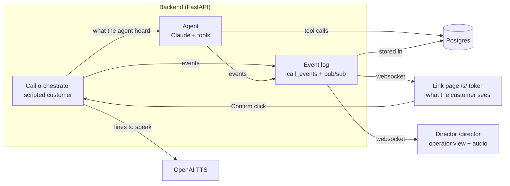

# Live Call Link Demo

> **Unofficial demo.** Not affiliated with or endorsed by Simple AI. All brands, people, phone numbers
> and orders in it are fictional.

During a phone call, an AI agent texts the customer a temporary, secured link. The page shows, live,
what the agent heard, what it's noting and doing, and the resulting cart or reservation. The customer
can catch a mistake while the call is still going and confirm before anything is committed.

Two scenarios:

- **Order (outbound).** Ava from Fieldstone Provisions calls Jamie about dry-aged ribeyes. Jamie asks
  for two; the agent hears "ten". Jamie sees 10 in the cart on the link and corrects it, accepts an
  add-on, and confirms on the page.
- **Reservation change (inbound).** Daniel calls Juniper Table to add a guest. The calendar on the
  link shows him the date is a Saturday, so he moves it to Friday, picks an open time, and confirms.

## What's real and what's simulated

**Real**
- The agent: Claude (Anthropic API) decides what to say and calls tools.
- The tools read and write Postgres: products, cart, reservation, availability.
- The link token: 32 random bytes, stored only as a SHA-256 hash. It's created when the call
  connects, sent only after the customer says yes, and revoked when the call ends.
- The link page renders from database events over a websocket, never from the script.
- Confirm is a real click. The agent can't place the order or confirm the reservation until that
  click arrives; the server enforces it.
- The voices: OpenAI text-to-speech.

**Simulated**
- The phone line: there's no telephony provider. The call runs in-process.
- The customer: scripted lines from a beat file (`backend/scenarios/*.yaml`), voiced with TTS.
- The SMS: shown as a text bubble in the director view. Nothing is sent.
- The mishearing: the customer's line says "two", but the agent is given "ten", standing in for a
  speech-recognition error.

**Replay mode** plays back a recorded live call (agent turns, tool results, voices) with long pauses
shortened. The link token, the link page and the Confirm click are still real.

## Architecture



Every change (a spoken turn, a tool call, the new cart or reservation, the link's status) is appended
to `call_events` and pushed to subscribers. The link page and the director rebuild everything they
show from that log, and resume from the last event after a reconnect.

## Run it

Needs Docker, Python 3.12 with [uv](https://docs.astral.sh/uv/), Node.js 22, and API keys for
Anthropic and OpenAI.

```bash
cp backend/.env.example backend/.env   # then fill in ANTHROPIC_API_KEY and OPENAI_API_KEY
make install                           # uv sync + npm install
make db-up                             # Postgres 16 in Docker, localhost:5433
make seed                              # demo products, customers and reservation
make backend                           # terminal 1: API on 127.0.0.1:8000
make frontend                          # terminal 2: web app on port 5180
```

Open <http://localhost:5180/director>, pick a scenario, choose **Live** (a new call with the live
agent) or **Replay** (one of the recorded takes in `backend/takes/`), and press Start. When the agent
asks, click Confirm inside the link page. Replay needs only the OpenAI key: the first run regenerates
the voice clips.

The director, replays and `/dev` pages use development-only API routes. They're off unless
`ENABLE_DEV_ROUTES=true`, which the example env file sets for local use. Run the demo locally only.

Other commands:

| Command | What it does |
|---|---|
| `make test` | Backend tests (separate test database, no LLM calls) |
| `make call S=order SPEED=4` | One call in the terminal with the live agent, then an end-state check (`TTS=1` adds voices) |
| `make director-screenshots` | Replays both takes in a headless browser, checks the timeline frame by frame, saves screenshots |

`scripts/windows/` and `make remote-info` are optional helpers for viewing the dev server from another
device on a Tailscale network when it runs under WSL.

## Built with Claude Code

[CLAUDE.md](CLAUDE.md) is the spec I wrote and handed to Claude Code, which built this repo from it.
The agent's instructions for each scenario are in `backend/scenarios/*.prompt.md`.
